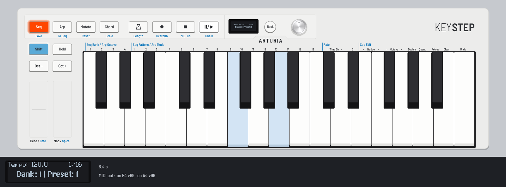

# KeyStep mk2 firmware notes

Reverse-engineering notes and tools for the firmware of the Arturia KeyStep mk2, working towards
custom firmware with an SDK and an emulator ([ROADMAP](docs/ROADMAP.md)). The stock firmware is
mapped and boots in the emulator. On one unit the bootloader has been read out, stock and modified
images flashed and verified, and SDK firmware run ([FLASHING](docs/FLASHING.md)).

Unofficial. Not affiliated with or endorsed by Arturia.



| Path | Contents |
|------|----------|
| `docs/ROADMAP.md` | The plan, the gating questions and the safety rules |
| `docs/FIRMWARE.md` | Where the firmware comes from, the package and image format, the processor |
| `docs/SYSEX.md` | The SysEx dispatcher: all 14 operations and the parameter id layout |
| `docs/VERSIONS.md` | What differs between the published versions |
| `docs/HARDWARE.md` | Clock, pin table, buses, display, LEDs, keybed, CV, external flash |
| `docs/user-guide.html`, `docs/USER-GUIDE.md` | The MK2000 user guide: a designed, standalone page, and the same facts as plain text |
| `docs/MK2000.md` | The MK2000 design: what the code is built to |
| `docs/SELFTEST.md` | The self-test firmware: what it checks on a unit and how to read its report |
| `docs/FLASHING.md` | How to flash a unit, check it and get back to stock; what never to send |
| `docs/BOOTLOADER.md` | Update mode and the bootloader: what a unit did, and the bootloader's code read |
| `docs/UPDATER.md` | How MIDI Control Center installs firmware (USB DFU with Arturia requests) |
| `firmware/` | The four published packages, unpacked, with hashes in `listing.json` |
| `tools/fwfetch.py` | Downloads and unpacks the packages |
| `tools/fwpack.py` | Reads, checks and builds images and packages |
| `tools/emu.py` | Runs an image on the host: Cortex-M0+ with models of the display, flash, LEDs, keys, buttons, encoder and touch strips |
| `tools/usbmodel.py` | The USB device controller and a host for it, used by the emulator |
| `tools/ksflash.py` | The firmware update as MIDI Control Center does it: flash, read back, verify. Used on a unit ([FLASHING.md](docs/FLASHING.md)) |
| `tools/flashdump.py` | Reassembles the external flash from the `flashdump` firmware's SysEx |
| `tools/emutest.py` | Checks of the stock firmware and the SDK examples in the emulator |
| `tools/fontextract.py` | Reads the stock display fonts out of an image, for the SDK |
| `tools/panel.py` | A window that looks like the KeyStep, on top of the emulator |
| `sdk/` | C SDK: start-up code, board drivers and examples that run in the emulator ([README](sdk/README.md)) |
| `ghidra/names-1.0.2.tsv` | Names for identified functions |
| `ghidra/` | Headless Ghidra pipeline: import, function seeding, export, version diff |

```bash
just fetch            # download and unpack all known versions
just selftest         # rebuild every stock header and compare
just host stock       # the stock firmware in a window you can click
just host hello       # build an app and open it in the same window
just host mk2000      # KeyStep MK2000: the four-track firmware (docs/MK2000.md)
just shot mk2000      # a picture of it after 3 s, as mk2000.png
just flash-sim hello  # rehearse flashing it: emulated device, model of the bootloader
just test             # run the stock firmware and the SDK examples through the emulator checks
just probe            # read a connected KeyStep's USB descriptors (sends nothing else)
just sim stock --ms 5000 --script "2500 tap=seq; 4000 show"   # the same without a window
just check            # lint and build every app
just analyze 1.0.4    # decompile one (needs Ghidra and a JDK)
```

## What is known so far

- The package is a zip with `info.json` and one image.
- The image is **not encrypted**: a 64-byte header, then a plain ARM Cortex-M0+ binary loaded at
  `0x08008000`. The header's two integrity fields are XOR sums.
- The processor is an STM32G0B1-class part.
- The SysEx dispatcher handles 14 operations; MIDI Control Center uses 9 of them. The version
  request and per-step parameter reads were confirmed on a device running 1.0.2; steps 1-56 of a
  pattern are readable as individual bytes.
- Updates go over USB DFU with three Arturia requests. MIDI Control Center does not inspect the
  image, so every check is the bootloader's. Arturia documents a recovery entry: hold Tempo while
  switching on.
- The board: 64 MHz, a 128×32 OLED, 54 addressable LEDs, a 512 KiB SPI flash with littlefs, a
  touch controller on I2C, MIDI DIN on USART1.
- The stock 1.0.2 image runs in the emulator and responds to every control: buttons, keys,
  encoder and touch strips. It sends the right MIDI on its DIN output, enumerates over USB and
  answers the SysEx version request there with the reply a real unit gave.
- The external flash holds 64 patterns, the settings, a file system with the factory
  calibration, and 124 KiB the stock firmware never uses; the SDK stores only there.
- In the emulator the stock firmware also plays its sequencer, follows an external clock, drives
  the CV, gate and sync pins and runs as the 37-key model. A pattern slot in the flash is the
  same 4096 bytes as a pattern in a `.keystep2` file.
- The SDK builds firmware with drivers for every mapped part including USB MIDI, CV, gate and
  sync, and a four-track sequencer runs on it. It can draw with the stock fonts, read from your
  copy of the image. `flashdump`, `bootdump` and MK2000 have been flashed to a unit; how MK2000
  behaves there is not yet written up.
- 1.0.1 and 1.0.2 contain identical code. 1.0.4 keeps the same SysEx operations and pattern
  parameter layout as 1.0.2 and adds global settings.

## Related

- `~/code/keystep2mk-decode` (keystep2-editor): the pattern file format and the MIDI SysEx protocol.
- `~/code/midicenter-reverse`: notes on MIDI Control Center itself.

## Caution

Flashing has been done on one 32-key unit, with a recovery path proven there
([FLASHING](docs/FLASHING.md)). Other units, the 37-key model and other bootloader revisions are
untried: read that file first, take the copy of the external flash it describes, and keep to the
"never send" list.

## Licence

The tools, the SDK, the examples and the notes are under the MIT licence ([LICENSE](LICENSE)).
That does not cover Arturia's firmware, which is not in this repository: `just fetch` downloads
the published packages from Arturia, and anything read from a unit stays in the git-ignored
`firmware/device/`. The Barlow fonts in `tools/assets` are under the SIL Open Font License
(`tools/assets/OFL.txt`).

