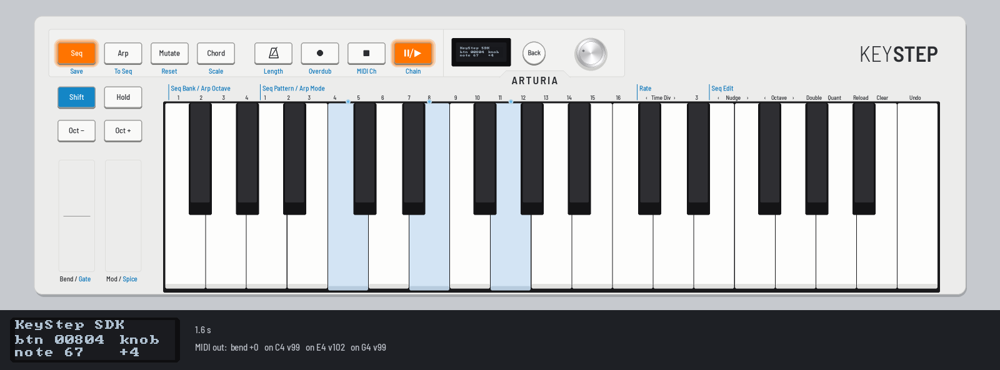
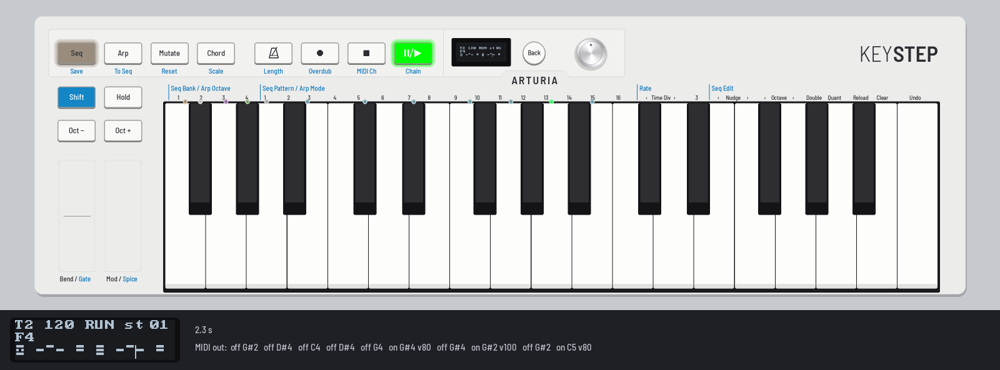

# KeyStep mk2 SDK

Build firmware for the Arturia KeyStep mk2 in C and run it in the emulator and the KeyStep
window.

**Status: runs on a unit, barely tried there.** `flashdump`, `bootdump` and `mk2000` have been
flashed to one 32-key unit with `just flash` ([FLASHING.md](../docs/FLASHING.md)). Shown to work on
it: start-up, clock, USB enumeration and USB MIDI out, the external flash driver (reads), the Play
button, and the update request. Everything else has only met the emulator's model of the board;
the drivers follow what the stock firmware does ([HARDWARE.md](../docs/HARDWARE.md)).



## Requirements

- `arm-none-eabi-gcc` and `arm-none-eabi-binutils` (Homebrew formulas of the same names)
- `uv`, which runs the packaging, emulator and window tools in `../tools`

## Use

Run these inside `sdk/`, or use the `just` recipes from the repository root (`just host hello`, `just sim hello`, `just build hello`).

```
make                    # build examples/hello -> build/hello/hello.img
make sim                # run it in the emulator and print the display
make sim SCRIPT="500 press=seq; 700 press=k0; 1400 show" MS=1500
make panel              # run it in the KeyStep window
make flash-sim          # rehearse flashing it: emulated device, model of the bootloader
make fonts              # write the stock fonts' header now (done by itself when a firmware includes it)
make new APP=myapp      # start examples/myapp from examples/hello
make APP=myapp panel
```

A firmware is a folder `examples/<name>/` with a `main.c`. The build has no C library:
`-nostdlib`, with `memcpy`, `memset` and `memmove` supplied by the SDK. It must compile without
warnings.

## Examples

| Folder | What it is |
|---|---|
| `examples/hello` | Shows every control, plays the keys as MIDI notes. The template for `make new`. |
| `examples/mk2000` | **KeyStep MK2000**, the full firmware: four tracks with ratchets, probability and conditions per step, channels changed with a held button and a numbered key, an arpeggiator, scales and chords, pattern chains, saved to flash. Design in [MK2000.md](../docs/MK2000.md); its engine, store, arpeggiator, clock and harmony have host tests in `examples/mk2000/tests`. |
| `examples/screens` | The MK2000 screens as still pictures in the stock fonts; turn the encoder. |
| `examples/seq4` | The first sketch of a four-track step sequencer: 16 steps, four notes per step, step and live recording, saved with Shift + Seq. Everything is on the display; the lights above the keys repeat it on the 37-key model. |
| `examples/flashdump` | Sends the whole external flash out as SysEx (USB if connected, else DIN) for `tools/flashdump.py`: the backup of a unit's patterns, settings and calibration. Reads only. |
| `examples/bootdump` | `flashdump` reading the processor's first 32 KiB instead: the bootloader, which is in no package. Reads only. |
| `examples/cv` | The keyboard as a CV source: pitch and gate from the keys, Mod 1 from the strip, Mod 2 from aftertouch, a clock on the sync output, and the inputs on the display. |
| `examples/fonts` | Text in the stock firmware's two fonts (see Fonts below). |
| `examples/flashtest` | Checks the external flash driver: chip id, the write guard, and a write and read-back in the last sector of the SDK's area. |



## API (`include/keystep.h`)

| Function | Does |
|---|---|
| `ks_init()` | 64 MHz clock, pins, display, keybed scan, LEDs, MIDI, touch controller |
| `ks_millis()`, `ks_delay_ms(ms)`, `ks_micros16()`, `ks_micros()` | time from the 1 ms tick, a 16-bit microsecond counter, and the same carried to 32 bits (wraps after 71 minutes) |
| `ks_timer_start(us, callback)`, `ks_timer_period(us)`, `ks_timer_stop()` | one periodic interrupt of your own, 50 to 65536 µs; `ks_timer_start` again restarts the count from now |
| `ks_oled_clear/pixel/rect/text/text_big/flush` | 128 × 32 frame buffer; the 8 × 8 font gives 16 × 4 characters |
| `ks_oled_text_font(font, x, y, text)`, `ks_font_width(font, text)` | proportional fonts, such as the stock firmware's (Fonts below) |
| `ks_utoa(value, out)` | decimal text, since there is no `printf` |
| `ks_buttons()` | the 13 buttons and Tempo as `KS_BTN_*` bits |
| `ks_encoder()` | detents turned since the last call, clockwise positive |
| `ks_key_get(&event)` | key down and up events with velocity; `ks_keys_down()` gives the held keys as bits |
| `ks_touch(strip)` | `KS_STRIP_BEND` or `KS_STRIP_MOD`: 0 to 255, or −1 with no finger |
| `ks_led(led, 0xRRGGBB)`, `ks_leds_show()` | the 39 LEDs above the keys (`KS_LED_KEY(n)`) and the button LEDs (`KS_LED_SEQ` …) |
| `ks_midi_send(status, d1, d2)`, `ks_midi_send_byte(b)`, `ks_midi_get()`, `ks_midi_tx_free()` | MIDI on the DIN sockets, buffered |
| `ks_midi_realtime(port, byte)` | define it to get each real-time byte (clock, Start, Stop, ...) from `KS_MIDI_DIN` or `KS_MIDI_USB` the moment it arrives, in the interrupt; the byte still reaches `ks_midi_get()` / `ks_usb_midi_get()` |
| `ks_usb_ready()`, `ks_usb_midi_send(status, d1, d2)`, `ks_usb_midi_send_byte(b)`, `ks_usb_midi_get()`, `ks_usb_midi_tx_free()` | USB MIDI, both directions, SysEx included |
| `ks_usb_sysex_send(message, len)`, `ks_version`, `ks_sysex_request(...)` | Arturia's SysEx requests on USB: the SDK answers the version request with `ks_version` (`0.0.1.0` unless you define it); define `ks_sysex_request` to answer others |
| `ks_cv_pitch(value)`, `ks_cv_mod(output, value)` | pitch CV (16 bit) and the two mod outputs (12 bit), raw values |
| `ks_gate(on)`, `ks_gate_format(format)` | the gate output and its three formats |
| `ks_sync_out(line, on)`, `ks_sync_in(line)`, `ks_sync_pulses()` | sync clock and run lines; pulses counted on the clock input |
| `ks_sync_clock_in()` | define it to hear each pulse on the clock input as it arrives, in the 65 µs interrupt |
| `ks_aftertouch()`, `ks_pedal()` | the two analog inputs, 0 to 4095 |
| `ks_store_save(slot, data, len)`, `ks_store_load(slot, data, max)` | 31 numbered records of up to 4088 bytes in the external flash, with a checksum |
| `ks_flash_id()`, `ks_flash_read()`, `ks_flash_erase()`, `ks_flash_write()` | the external flash directly; erase and write only work in the SDK's area (below) |
| `ks_reset()`, `ks_enter_update_mode()` | system reset; the update-mode request (used on a unit by `ksflash.py`'s `0xF2`) |

## Fonts

The SDK's own font is a plain 8 × 8 one. The stock firmware's two fonts (9 and 15 pixels tall,
proportional) can be used as well:

```c
#include "keystep_fonts.h"
ks_oled_text_font(&ks_font_small, 0, 0, "Tempo");
ks_oled_text_font(&ks_font_large, 0, 9, "120.0");
```

Including the header is the switch: the build then runs `tools/fontextract.py`, which reads the
fonts out of your copy of the stock image in `../firmware` and writes
`build/generated/keystep_fonts.h`. The fonts are Arturia's, so the header is generated and not
part of the SDK; do not publish it or a firmware built with it without their permission.
`uv run tools/fontextract.py show 1 "Text"` previews a font in the terminal. Any other font
can be drawn the same way by filling a `ks_font`.

## How it runs

- **Interrupts:** a 1 ms tick (time, encoder, one analog conversion), a 65 µs timer (one keybed
  phase, one MIDI byte each way, the sync clock input) and USB. Everything else is polled from
  your main loop, except the hooks you define: `ks_timer_start`'s callback, `ks_midi_realtime`
  and `ks_sync_clock_in` run in interrupts, which do not interrupt each other. The SDK's own
  short critical sections put interrupts back as they found them, so its functions can be called
  with interrupts off (to send a message whole, for example).
- **CV and gate:** the functions take the raw numbers the processor outputs. The stock firmware
  with no calibration uses `(note − 36) × 65536 / 120` for pitch; what voltage that gives, and
  the unit's own calibration in its flash, are not handled.
- **Blocking calls:** `ks_leds_show()` takes about 3 ms, `ks_oled_flush()` under 1 ms, and
  `ks_touch()` about 0.5 ms when the controller has a new report.
- **USB:** the device presents the stock firmware's identity and descriptors (`1C75:0228`,
  "KeyStep mk2"), so a host and MIDI Control Center see a KeyStep. Define `ks_usb_product` in
  your firmware to change the name. The host's update request (`0xF2`) is honoured like the
  stock firmware does: 500 ms later the firmware leaves the marker and resets into the
  bootloader. The clock is HSI48 without trimming, as in the stock firmware.
- **External flash:** the stock firmware keeps 64 patterns at `0x00000`, its settings at
  `0x40000` and the factory calibration in a file system at `0x60000`. It never addresses
  `0x41000`–`0x5FFFF`, so the SDK stores there (`KS_FLASH_USER`). `ks_flash_erase` and
  `ks_flash_write` refuse every other address unless `ks_flash_allow_stock_area(1)` was called.
  An erase can take up to 0.5 s on the chip; the emulator answers at once. A save erases its
  sector first, so power lost during a save loses that record.
- **Memory:** 480 KiB of flash from `0x08008000` and 144 KiB of RAM. The first 32 bytes of RAM
  belong to the bootloader hand-over and are left alone.

## Not there yet

- Calibrated CV: the unit's calibration files are not read, and no voltage has been measured.
- Reading the stock firmware's patterns and settings (their layout is in
  [HARDWARE.md](../docs/HARDWARE.md)) and its file system on the external flash.
- The 37-key model: the emulator can run it, the SDK drivers assume 32 keys and one encoder.
- What the bootloader does with the marker `ks_enter_update_mode()` leaves, and the LED order
  above the keys, are not known until checked on a device.

## Rules

- No write to the external flash outside `0x41000`–`0x5FFFF` until the unit's flash has been
  read out and kept: the calibration at `0x60000` is per unit and is not in any firmware package.

- No code that writes flash below `0x08008000` or touches the option bytes. The bootloader is
  the only way back from a bad image.
- Report emulator results and hardware results separately. Running in the emulator does not
  show that a firmware works on the device.
